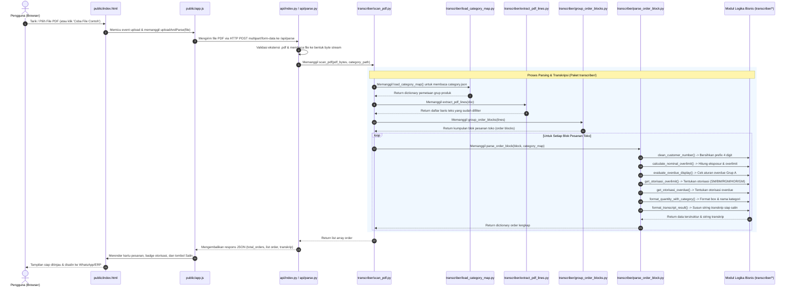

# Runtutan File & Fungsi Proses Transkrip Laporan Credix

Dokumen ini menjelaskan secara rinci dan runut bagaimana file-file dan fungsi-fungsi di dalam proyek ini saling memanggil, bertukar data, dan bekerja sama untuk mengubah dokumen PDF laporan pesanan Credix (FRM-LOG-027) menjadi hasil transkrip teks yang rapi dan siap disalin.

---

## 1. Diagram Alur Keseluruhan (End-to-End Architecture)

Berikut adalah diagram visual alur pemrosesan data dari awal user mengunggah file hingga transkrip tampil di layar:



---

## 2. Runtutan Proses Langkah demi Langkah

### Langkah 1: Interaksi Pengguna di Antarmuka Web
1. **File:** [`public/index.html`](file:///D:/DOT%20Indonesia/Project/ranis/transkrip/public/index.html)
   - **Fungsi / Peran:** Menyediakan antarmuka visual pengguna, meliputi area *Drag and Drop* (`#dropZone`), tombol input file (`#fileInput`), tombol cepat *"Coba File Contoh"* (`#sampleBtn`), indikator *loading* animasi (`#loadingState`), dan wadah hasil kartu order (`#ordersList`).
   - **Apa yang terjadi selanjutnya:** Saat user memilih file PDF atau mengklik tombol, interaksi ini ditangkap oleh script JavaScript di sisi browser.

2. **File:** [`public/app.js`](file:///D:/DOT%20Indonesia/Project/ranis/transkrip/public/app.js)
   - **Fungsi yang berjalan:** `init()`, `handleFileSelect()`, dan `uploadAndParse(file)` (atau `loadSampleFile()` jika memilih file contoh).
   - **Tugasnya:**
     - Membaca objek file PDF dari input pengguna.
     - Mengubah status tampilan web ke mode *loading* (menampilkan animasi putar dan pesan status).
     - Mengemas file PDF ke dalam objek `FormData` dengan kunci parameter bernama `'file'`.
     - Mengirimkan request HTTP POST menggunakan `fetch()` ke endpoint backend: `/api/parse`.
   - **Selanjutnya menuju ke:** Layer backend API di server.

---

### Langkah 2: Penerimaan & Validasi Permintaan HTTP di Backend
3. **File:** [`api/index.py`](file:///D:/DOT%20Indonesia/Project/ranis/transkrip/api/index.py) (atau [`api/parse.py`](file:///D:/DOT%20Indonesia/Project/ranis/transkrip/api/parse.py) pada lingkungan serverless Vercel)
   - **Fungsi yang berjalan:** `parse_pdf()` (atau `handle_parse()`).
   - **Tugasnya:**
     - Menangkap kiriman data multipart dari browser.
     - Melakukan validasi awal: memastikan parameter `file` tersedia, file tidak kosong (bukan 0 byte), dan ekstensi file berakhiran `.pdf`.
     - Membaca seluruh isi file PDF ke dalam memori sebagai aliran byte murni: `pdf_bytes = file.read()`.
     - Menentukan lokasi file referensi kategori produk melalui fungsi helper `get_category_path()` yang mengarah ke [`category.json`](file:///D:/DOT%20Indonesia/Project/ranis/transkrip/category.json).
     - Meneruskan data byte PDF dan path kategori ke mesin pemrosesan utama dengan memanggil:
       ```python
       from transcriber import scan_pdf
       orders = scan_pdf(pdf_bytes, cat_path)
       ```
   - **Selanjutnya menuju ke:** Orkestrator utama pemrosesan PDF di paket `transcriber`.

---

### Langkah 3: Orkestrasi Pemrosesan Dokumen PDF
4. **File:** [`transcriber/scan_pdf.py`](file:///D:/DOT%20Indonesia/Project/ranis/transkrip/transcriber/scan_pdf.py)
   - **Fungsi yang berjalan:** `scan_pdf(pdf_path, category_json_path)`
   - **Tugasnya sebagai konduktor/orkestrator:**
     - Membuka file atau byte stream PDF menggunakan library PyMuPDF (`pymupdf.open(stream=pdf_bytes, filetype="pdf")`).
     - Memanggil fungsi pemuat kategori produk ke file [`transcriber/load_category_map.py`](file:///D:/DOT%20Indonesia/Project/ranis/transkrip/transcriber/load_category_map.py).
     - Mengirim objek dokumen PDF ke modul ekstraksi baris [`transcriber/extract_pdf_lines.py`](file:///D:/DOT%20Indonesia/Project/ranis/transkrip/transcriber/extract_pdf_lines.py).
     - Mengirim baris-baris hasil ekstraksi ke modul pengelompokan pesanan [`transcriber/group_order_blocks.py`](file:///D:/DOT%20Indonesia/Project/ranis/transkrip/transcriber/group_order_blocks.py).
     - Mengulangi (*looping*) setiap blok pesanan toko dan memprosesnya melalui [`transcriber/parse_order_block.py`](file:///D:/DOT%20Indonesia/Project/ranis/transkrip/transcriber/parse_order_block.py).
     - Mengembalikan daftar dictionary seluruh pesanan yang telah lengkap ditranskripsikan.

5. **File:** [`transcriber/load_category_map.py`](file:///D:/DOT%20Indonesia/Project/ranis/transkrip/transcriber/load_category_map.py)
   - **Fungsi yang berjalan:** `load_category_map(category_json_path)`
   - **Tugasnya:** Membaca file [`category.json`](file:///D:/DOT%20Indonesia/Project/ranis/transkrip/category.json) dan mengubahnya menjadi dictionary Python:
     ```python
     {"A": "Kopi Reguler SJA", "B": "Candy Agel", "EJH": "Home Care", ...}
     ```
   - **Output:** Dikembalikan ke `scan_pdf` untuk digunakan nanti saat menentukan nama kategori produk.

---

### Langkah 4: Ekstraksi Geometris Teks & Segmentasi Blok Pesanan
6. **File:** [`transcriber/extract_pdf_lines.py`](file:///D:/DOT%20Indonesia/Project/ranis/transkrip/transcriber/extract_pdf_lines.py)
   - **Fungsi yang berjalan:** `extract_pdf_lines(doc)`
   - **Tugasnya:**
     - Membaca setiap halaman dokumen dan mengekstrak koordinat posisi seluruh kata (`page.get_text("words")`). Setiap kata memiliki posisi `(x0, y0, x1, y1, text)`.
     - **Penyaringan Elemen Statis:** Membuang teks kop laporan atas yang berulang ($y < 85$) serta tanda tangan footer bawah ($y > 750$).
     - **Pengelompokan Baris Horizontal:** Mengelompokkan kata-kata yang memiliki koordinat vertikal $y$ yang sejajar (toleransi selisih $\leq 2.5$) dari kiri ke kanan.
   - **Output:** Menghasilkan kumpulan baris teks terurut: `list[tuple[y_coordinate, list_of_words]]`.
   - **Selanjutnya menuju ke:** Modul segmentasi pesanan.

7. **File:** [`transcriber/group_order_blocks.py`](file:///D:/DOT%20Indonesia/Project/ranis/transkrip/transcriber/group_order_blocks.py)
   - **Fungsi yang berjalan:** `group_order_blocks(lines)`
   - **Tugasnya:**
     - Membaca baris demi baris teks untuk mendeteksi penanda awal pesanan toko baru (*Header Baris Order*).
     - Syarat order baru: kolom kiri memiliki angka nomor urut ($15 \le x \le 35$), kolom kedua berupa nama toko ($40 \le x \le 110$), dan kolom tengah memuat format tanggal order `\d{2}-[A-Z]{3}-\d{2}` ($450 \le x \le 510$).
     - Baris-baris berikutnya yang berada di bawah header tersebut dimasukkan sebagai isi rincian pesanan (`body_lines`).
     - **Penanganan Multi-Halaman (*Cross-Page*):** Jika rincian faktur toko terpotong di akhir halaman dan bersambung ke halaman berikutnya, sistem tetap menggabungkannya ke dalam satu blok toko yang sama hingga menemukan baris header toko berikutnya.
   - **Output:** Kumpulan blok order: `list[dict{"header_words": [...], "body_lines": [...]}]`.
   - **Selanjutnya menuju ke:** Pemecahan rincian dan kalkulasi per toko.

---

### Langkah 5: Ekstraksi Rincian Order & Eksekusi Logika Bisnis
8. **File:** [`transcriber/parse_order_block.py`](file:///D:/DOT%20Indonesia/Project/ranis/transkrip/transcriber/parse_order_block.py)
   - **Fungsi yang berjalan:** `parse_order_block(block, category_map)`
   - **Tugasnya:** Mengambil satu blok pesanan toko, mengekstrak kolom-kolomnya, dan memanggil fungsi-fungsi logika bisnis spesifik:
     - Mengambil nomor urut order, nama toko, tanggal order, dan nilai rupiah orderan.
     - Menemukan nomor customer (pola `0100-XXXXXXX`), lalu memanggil:
       👉 **[`transcriber/clean_customer_number.py`](file:///D:/DOT%20Indonesia/Project/ranis/transkrip/transcriber/clean_customer_number.py)** $\rightarrow$ Menghilangkan prefix 4 digit awal sehingga menjadi nomor murni (misal: `0029325`).
     - Menemukan baris total kuantiti box dan non-box dari `body_lines`.
     - Menelusuri baris `SALESPERSON` untuk membaca nama sales, jangka waktu kredit (*term*), dan batas limit kredit resmi.
     - Mengekstrak tabel daftar faktur piutang yang masih menggantung: Nomor Faktur, Jatuh Tempo (*Due Date*), Hari Keterlambatan (*Overdue*), dan Nilai Nominal Faktur.
     - Menjumlahkan seluruh sisa piutang faktur menjadi nilai `total_piutang`.

   - **Kemudian menjalankan kalkulasi bisnis dengan memanggil file-file helper:**
     - **Kalkulasi Overlimit:**
       Memanggil 👉 **[`transcriber/calculate_nominal_overlimit.py`](file:///D:/DOT%20Indonesia/Project/ranis/transkrip/transcriber/calculate_nominal_overlimit.py)**:
       Menghitung eksposur total: `Amount Order + Sisa Piutang`.
       Nominal Overlimit: `Eksposur Total - Limit Kredit`.
       Persentase Overlimit: `(Nominal Overlimit / Limit Kredit) * 100%`.
     
     - **Pengecekan Tampilan Overdue:**
       Memanggil 👉 **[`transcriber/evaluate_overdue_display.py`](file:///D:/DOT%20Indonesia/Project/ranis/transkrip/transcriber/evaluate_overdue_display.py)**:
       Mengevaluasi apakah hari overdue ditampilkan berdasarkan aturan:
       - Jika toko Overlimit $\rightarrow$ Tampilkan hari keterlambatan overdue.
       - Jika toko Underlimit $\rightarrow$ Overdue hanya ditampilkan jika faktur berasal dari produk Grup A (Kopi Reguler) dengan hari keterlambatan $\ge 0$.
     
     - **Penentuan Kewenangan Otorisasi Overlimit:**
       Memanggil 👉 **[`transcriber/get_otorisasi_overlimit.py`](file:///D:/DOT%20Indonesia/Project/ranis/transkrip/transcriber/get_otorisasi_overlimit.py)**:
       Mencocokkan limit kredit dan persentase overlimit ke matriks SOP perusahaan untuk menentukan apakah persetujuan cukup di tingkat `SM`, `BM`, `RGM`, `HOR`, atau harus `GM`.
     
     - **Penentuan Kewenangan Otorisasi Overdue:**
       Memanggil 👉 **[`transcriber/get_otorisasi_overdue.py`](file:///D:/DOT%20Indonesia/Project/ranis/transkrip/transcriber/get_otorisasi_overdue.py)**:
       Mencocokkan jumlah hari keterlambatan dan limit kredit ke matriks otorisasi overdue (`BM`, `RGM`, `HOR`, atau `GM`).
     
     - **Format Kuantiti & Kategori Produk:**
       Memanggil 👉 **[`transcriber/format_quantity_with_category.py`](file:///D:/DOT%20Indonesia/Project/ranis/transkrip/transcriber/format_quantity_with_category.py)**:
       Menghubungkan kode grup barang (misal `"A"`) dengan `category_map` untuk menghasilkan teks berformat: `"Kopi Reguler SJA 18 Box (Total Non Box: 0)"`.
     
     - **Penyusunan Format Transkrip Teks:**
       Memanggil 👉 **[`transcriber/format_transcript_result.py`](file:///D:/DOT%20Indonesia/Project/ranis/transkrip/transcriber/format_transcript_result.py)**:
       Menggabungkan seluruh data toko menjadi string transkrip siap pakai:
       ```text
       Tanggal order       : 12-OCT-26
       Nama toko           : TOKO HIDUP BARU STR BM
       Nomor customer      : 0029325
       Limit kredit        : Rp 200,000

       Amount penjualan    : Rp 850,978

       Quantity            : Kopi Reguler SJA 0 Box (Total Non Box: 77)

       List Piutang faktur :
         (Tidak ada faktur piutang menggantung)
         * Total Piutang Faktur: Rp 0.00

       Persentase overlimit: Rp 650,978 (325%)
       Overdue             : -

       Otorisasi OverLimit : BM
       Otorisasi OverDue   : 
       ```

---

### Langkah 6: Pengembalian Data ke Browser & Rendering UI
9. **File:** [`api/index.py`](file:///D:/DOT%20Indonesia/Project/ranis/transkrip/api/index.py)
   - Menerima kumpulan dictionary order dari `scan_pdf()`.
   - Mengemasnya ke dalam format JSON standar HTTP 200:
     ```json
     {
       "success": true,
       "filename": "laporan_credix.pdf",
       "total_orders": 11,
       "orders": [ ... ]
     }
     ```
   - Mengirim respons tersebut kembali ke peramban web pengguna.

10. **File:** [`public/app.js`](file:///D:/DOT%20Indonesia/Project/ranis/transkrip/public/app.js) & [`public/index.html`](file:///D:/DOT%20Indonesia/Project/ranis/transkrip/public/index.html)
    - **Fungsi yang berjalan:** `renderResults(data)`, `renderOrderCard()`, dan `renderOrderTabs()`.
    - **Tugasnya:**
      - Menyembunyikan tampilan spinner loading (`#loadingState`).
      - Menampilkan bagian hasil (`#resultsSection`).
      - Membuat tab navigasi cepat untuk berpindah antar toko (`#orderTabs`).
      - Merender kartu visual pesanan lengkap dengan badge status (Overlimit %, Overdue hari, dan nama atasan otorisasi).
      - Mengaktifkan fungsi tombol **"Salin"** per baris teks serta tombol **"Salin Transkrip Order Ini"** dan **"Salin Semua Transkrip"** yang langsung menempelkan teks rapi ke clipboard pengguna.

---

## 3. Matriks Hubungan Antar-File (Caller vs Callee)

Tabel berikut merangkum hubungan panggilan langsung antar file di dalam proyek:

| File Pemanggil (*Caller*) | File yang Dipanggil (*Callee*) | Fungsi yang Dieksekusi | Data yang Dikirim (Input) | Data yang Dikembalikan (Output) |
|---|---|---|---|---|
| `public/index.html` | `public/app.js` | Event Handler (`click`, `drop`) | Event pengguna & File PDF | Memulai proses parsing |
| `public/app.js` | `api/index.py` | HTTP POST `/api/parse` | `FormData` (file PDF) | Objek JSON hasil transkripsi |
| `api/index.py` | `transcriber/scan_pdf.py` | `scan_pdf()` | `pdf_bytes` & `cat_path` | List of dict pesanan toko |
| `transcriber/scan_pdf.py` | `transcriber/load_category_map.py` | `load_category_map()` | Path `category.json` | Dict `{grup: kategori}` |
| `transcriber/scan_pdf.py` | `transcriber/extract_pdf_lines.py` | `extract_pdf_lines()` | Objek PDF Document | List baris kata berkoordinat |
| `transcriber/scan_pdf.py` | `transcriber/group_order_blocks.py` | `group_order_blocks()` | List baris kata | List blok pesanan toko |
| `transcriber/scan_pdf.py` | `transcriber/parse_order_block.py` | `parse_order_block()` | Blok toko & `category_map` | Dict detail pesanan toko |
| `transcriber/parse_order_block.py` | `transcriber/clean_customer_number.py` | `clean_customer_number()` | String `0100-XXXXX` | String bersih `XXXXX` |
| `transcriber/parse_order_block.py` | `transcriber/calculate_nominal_overlimit.py` | `calculate_nominal_overlimit()` | Order, Piutang, Limit | Nominal, % overlimit, format str |
| `transcriber/parse_order_block.py` | `transcriber/evaluate_overdue_display.py` | `evaluate_overdue_display()` | Status OL, Grup, Hari OD | Tuple `(should_display, hari_od)` |
| `transcriber/parse_order_block.py` | `transcriber/get_otorisasi_overlimit.py` | `get_otorisasi_overlimit()` | Limit, % Over, Total Piutang | Singkatan jabatan (`BM`, `HOR`, dll) |
| `transcriber/parse_order_block.py` | `transcriber/get_otorisasi_overdue.py` | `get_otorisasi_overdue()` | Limit, Hari OD | Singkatan jabatan (`RGM`, `GM`, dll) |
| `transcriber/parse_order_block.py` | `transcriber/format_quantity_with_category.py` | `format_quantity_with_category()` | Grup, Box, Non-Box, Map | String deskripsi kuantiti |
| `transcriber/parse_order_block.py` | `transcriber/format_transcript_result.py` | `format_transcript_result()` | Dict data toko lengkap | String teks transkrip terformat |

---

## 4. Jalur Alternatif: Eksekusi Terminal Langsung (CLI Runner)

Selain diakses melalui antarmuka web, sistem ini juga dapat dijalankan secara langsung dari konsol Command Prompt / PowerShell:

```bash
python order_scanner.py file/file_2.pdf
```

Pada skenario ini, alur eksekusi memotong lapisan frontend dan API:
1. **[`order_scanner.py`](file:///D:/DOT%20Indonesia/Project/ranis/transkrip/order_scanner.py)** membaca path PDF dari argumen terminal (`sys.argv[1]`).
2. `order_scanner.py` langsung memanggil `scan_pdf()` dari modul **[`transcriber`](file:///D:/DOT%20Indonesia/Project/ranis/transkrip/transcriber)**.
3. Seluruh proses parsing geometris, deteksi multi-halaman, dan perhitungan formula berjalan persis sama di dalam paket `transcriber/`.
4. Hasil transkrip dicetak langsung ke layar terminal melalui fungsi `format_transcript_result()`.

---

## 5. Ringkasan Kesimpulan
Arsitektur proyek telah memisahkan antara:
- **Presentation Layer (`public/`):** Bertanggung jawab atas interaksi visual dan kenyamanan penyalinan data.
- **Service/API Layer (`api/`):** Bertanggung jawab atas penerimaan berkas, protokol HTTP, dan kompatibilitas serverless.
- **Business Logic & Engine Layer (`transcriber/`):** Bertanggung jawab atas algoritma pembedahan PDF dan seluruh aturan otorisasi kredit yang modular (1 fungsi per file) sehingga mudah dipelihara, diuji, dan dikembangkan di masa mendatang.
