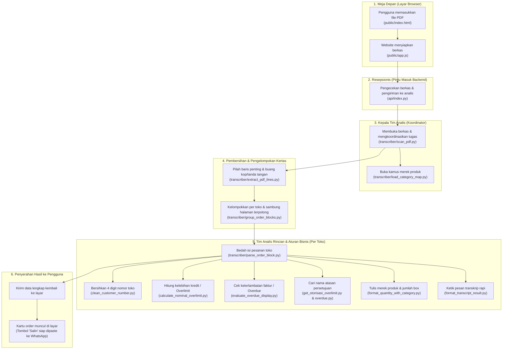

# Panduan Alur Kerja Sistem Transkrip Credix (Versi Non-IT / Bahasa Awam)

Dokumen ini disusun khusus agar **rekan-rekan non-IT, manajemen, staf operasional, maupun klien** dapat memahami dan mempresentasikan bagaimana sistem membaca file PDF laporan Credix dan mengubahnya menjadi transkrip siap pakai secara otomatis.

---

## 💡 Analogi Sederhana: "Kantor Operasional Digital"

Agar mudah dibayangkan oleh audiens awam, sistem ini bekerja persis seperti sebuah **kantor administrasi cerdas** yang memiliki pos-pos tugas teratur:

1. **Meja Depan (Front Office):** Tempat user memasukkan dokumen PDF di layar website.
2. **Resepsionis / Pengatur Masuk (API Router):** Memeriksa kelayakan dokumen dan meneruskannya ke ruang analis.
3. **Kepala Tim Analis (Orchestrator):** Mengatur jalannya pemeriksaan dokumen dan membagi tugas ke staf spesialis.
4. **Petugas Pemilah & Penyambung Halaman:** Membaca baris teks, membuang kop surat/tanda tangan, dan menyatukan pesanan yang terpotong antar-halaman.
5. **Petugas Kalkulator & SOP Otorisasi:** Menghitung kelebihan batas kredit (overlimit), mengecek tunggakan (overdue), dan menentukan siapa atasan yang wajib memberi persetujuan (*SM, BM, RGM, HOR, GM*).
6. **Sekretaris Pengetik Transkrip:** Menyusun seluruh hasil hitungan menjadi format pesan rapi yang siap dikirim ke WhatsApp hanya dengan satu kali klik.

---

## 🗺️ Diagram Alur Proses Kerja

---

## 📋 Penjelasan Runtutan File & Fungsinya (Langkah demi Langkah)

Berikut adalah urutan perjalanan dokumen dari awal user menaruh file hingga hasil transkrip keluar:

---

### Tahap 1: Pengguna Mengunggah Berkas di Website
* **File Pertama:** [`public/index.html`](file:///D:/DOT%20Indonesia/Project/ranis/transkrip/public/index.html)  
  * **Peran:** Ini adalah **layar tampilan web** yang dilihat oleh pengguna di laptop atau ponsel.
  * **Tugasnya:** Menyediakan kotak tempat menarik (*drag & drop*) file PDF, tombol memilih dokumen, serta tombol instan *"Coba File Contoh"*.

* **File Kedua:** [`public/app.js`](file:///D:/DOT%20Indonesia/Project/ranis/transkrip/public/app.js)  
  * **Peran:** **Asisten Layar Web**.
  * **Tugasnya:** Saat user memilih file PDF, file ini langsung menampilkan animasi putar (*loading*), membungkus dokumen PDF tersebut, lalu mengirimkannya ke kantor belakang (server) untuk diproses.
  * **Kata Kunci Presentasi:** *"Di layar ini user cukup menarik file PDF atau klik 'Coba File Contoh'. Asisten web langsung mengirim dokumen ke sistem pemrosesan dalam hitungan milidetik."*

---

### Tahap 2: Dokumen Diterima oleh Pintu Masuk Server
* **File Ketiga:** [`api/index.py`](file:///D:/DOT%20Indonesia/Project/ranis/transkrip/api/index.py) (atau [`api/parse.py`](file:///D:/DOT%20Indonesia/Project/ranis/transkrip/api/parse.py))  
  * **Peran:** **Pintu Masuk / Resepsionis Utama**.
  * **Tugasnya:**
    1. Memastikan file yang dikirim benar-benar dokumen PDF dan ukurannya tidak kosong.
    2. Menyiapkan kamus kategori barang ([`category.json`](file:///D:/DOT%20Indonesia/Project/ranis/transkrip/category.json)).
    3. Menyerahkan berkas tersebut ke ruang tim pembedah dokumen (`transcriber`).
  * **Kata Kunci Presentasi:** *"Pintu masuk server bertugas memvalidasi bahwa berkas aman dan valid, lalu langsung menyerahkannya ke mesin inti pembaca laporan."*

---

### Tahap 3: Kepala Koordinator Membuka Dokumen
* **File Keempat:** [`transcriber/scan_pdf.py`](file:///D:/DOT%20Indonesia/Project/ranis/transkrip/transcriber/scan_pdf.py)  
  * **Peran:** **Kepala Koordinator Pemrosesan**.
  * **Tugasnya:** Ini adalah pusat komando. File ini membuka file PDF secara digital, lalu mengatur giliran kerja staf-staf khususnya: memuat kamus merek, membaca baris teks, memisahkan per toko, hingga merangkai hasil akhirnya.

* **File Kelima:** [`transcriber/load_category_map.py`](file:///D:/DOT%20Indonesia/Project/ranis/transkrip/transcriber/load_category_map.py)  
  * **Peran:** **Penyedia Kamus Merek Barang**.
  * **Tugasnya:** Membaca daftar kode barang dari file `category.json` sehingga sistem tahu bahwa kode huruf `"A"` adalah *"Kopi Reguler SJA"*, kode `"EJH"` adalah *"Home Care"*, dan seterusnya.
  * **Kata Kunci Presentasi:** *"Koordinator sistem membuka dokumen dan langsung mencocokkan kode-kode barang ke kamus resmi merek perusahaan."*

---

### Tahap 4: Membersihkan Kertas & Menyambung Halaman
* **File Keenam:** [`transcriber/extract_pdf_lines.py`](file:///D:/DOT%20Indonesia/Project/ranis/transkrip/transcriber/extract_pdf_lines.py)  
  * **Peran:** **Penyaring Teks & Pembersih Kertas**.
  * **Tugasnya:**
    1. Membaca posisi semua kata di lembaran PDF.
    2. Membuang bagian yang tidak diperlukan, seperti kop judul laporan di bagian atas lembaran dan kolom tanda tangan di bagian bawah lembaran.
    3. Merapikan kata-kata yang sejajar menjadi satu baris kalimat yang lurus dan runtut.

* **File Ketujuh:** [`transcriber/group_order_blocks.py`](file:///D:/DOT%20Indonesia/Project/ranis/transkrip/transcriber/group_order_blocks.py)  
  * **Peran:** **Pemisah Berkas per Toko**.
  * **Tugasnya:** Mengenali tanda awal setiap pesanan (yaitu baris yang memuat nomor urut, nama toko, dan tanggal). Semua baris di bawah nama toko tersebut dikelompokkan menjadi satu berkas toko.
  * **Keunggulan Khusus:** Jika pesanan suatu toko sangat panjang sehingga terpotong di ujung lembar kertas dan bersambung ke halaman berikutnya (*cross-page*), staf ini secara cerdas tetap menyatukannya ke toko yang sama.
  * **Kata Kunci Presentasi:** *"Sistem memisahkan pesanan per toko dan secara otomatis menyambungkan data yang terpotong antar-halaman tanpa ada yang tercecer."*

---

### Tahap 5: Menganalisis Rincian & Menjalankan Aturan Bisnis
* **File Kedelapan:** [`transcriber/parse_order_block.py`](file:///D:/DOT%20Indonesia/Project/ranis/transkrip/transcriber/parse_order_block.py)  
  * **Peran:** **Analis Utama Detail Pesanan**.
  * **Tugasnya:** Membedah berkas masing-masing toko satu per satu (mengambil batas kredit toko, nama sales, daftar faktur yang belum lunas, dan nilai pesanan baru).
  * Untuk menghitung angka dan statusnya, analis ini meminta bantuan 6 staf spesialis:

  1. 👉 [`transcriber/clean_customer_number.py`](file:///D:/DOT%20Indonesia/Project/ranis/transkrip/transcriber/clean_customer_number.py)  
     **Tugas:** Membersihkan 4 digit kode awal langganan (misal `0100-0029325` dibersihkan menjadi `0029325`) agar staf langsung mudah mencarinya di program database toko.

  2. 👉 [`transcriber/calculate_nominal_overlimit.py`](file:///D:/DOT%20Indonesia/Project/ranis/transkrip/transcriber/calculate_nominal_overlimit.py)  
     **Tugas:** Menjalankan rumus resmi overlimit perusahaan:  
     `Total Beban = Orderan Baru + Piutang Menggantung`  
     `Nominal Overlimit = Total Beban - Batas Limit Kredit Toko`  
     Sistem langsung menghitung berapa rupiah dan berapa persen kelebihannya tanpa perlu kalkulator manual.

  3. 👉 [`transcriber/evaluate_overdue_display.py`](file:///D:/DOT%20Indonesia/Project/ranis/transkrip/transcriber/evaluate_overdue_display.py)  
     **Tugas:** Memeriksa keterlambatan jatuh tempo faktur lama. Sesuai SOP, jika toko overlimit maka keterlambatan wajib ditampilkan; namun jika belum overlimit, sistem cerdas hanya menampilkan keterlambatan jika menyangkut produk utama kopi (Grup A).

  4. 👉 [`transcriber/get_otorisasi_overlimit.py`](file:///D:/DOT%20Indonesia/Project/ranis/transkrip/transcriber/get_otorisasi_overlimit.py) & [`get_otorisasi_overdue.py`](file:///D:/DOT%20Indonesia/Project/ranis/transkrip/transcriber/get_otorisasi_overdue.py)  
     **Tugas:** Mencocokkan batas limit dan persentase overlimit ke lembar aturan SOP perusahaan untuk menentukan atasan mana yang berhak menandatangani:
     - Cukup Sales Manager (**SM**) atau Branch Manager (**BM**)?
     - Atau harus naik ke Regional GM (**RGM**), Head of Region (**HOR**), sampai General Manager (**GM**)?

  5. 👉 [`transcriber/format_quantity_with_category.py`](file:///D:/DOT%20Indonesia/Project/ranis/transkrip/transcriber/format_quantity_with_category.py)  
     **Tugas:** Menuliskan keterangan jumlah barang lengkap dengan merek resminya, contoh: *"Kopi Reguler SJA 18 Box (Total Non Box: 0)"*.

  6. 👉 [`transcriber/format_transcript_result.py`](file:///D:/DOT%20Indonesia/Project/ranis/transkrip/transcriber/format_transcript_result.py)  
     **Tugas:** Merangkum seluruh hasil analisa tadi menjadi susunan kalimat transkrip 13 baris yang terstandar dan siap kirim.
  * **Kata Kunci Presentasi:** *"Di tahap inilah seluruh rumus hitung, pengecekan faktur nunggak, dan penentuan pejabat persetujuan dieksekusi secara instan dan 100% patuh pada SOP perusahaan."*

---

### Tahap 6: Menyajikan Hasil ke Hadapan Pengguna
* **File Kesembilan:** Kembali ke [`public/app.js`](file:///D:/DOT%20Indonesia/Project/ranis/transkrip/public/app.js) & [`public/index.html`](file:///D:/DOT%20Indonesia/Project/ranis/transkrip/public/index.html)  
  * **Peran:** **Penyaji Hasil Transkrip**.
  * **Tugasnya:**
    1. Menghilangkan putaran animasi loading.
    2. Menampilkan kartu-kartu pesanan toko lengkap dengan warna status (merah jika overlimit, hijau jika aman).
    3. Menyediakan tombol **"Salin Transkrip Order Ini"** dan **"Salin Semua Transkrip"**. User cukup mengklik tombol tersebut, lalu langsung menekan Tempel (*Paste / Ctrl+V*) ke WhatsApp grup atau email atasan.
  * **Kata Kunci Presentasi:** *"Hasil langsung tertata rapi di layar. Tim kerja tinggal menekan tombol Salin dan menempelkannya ke WhatsApp. Selesai dalam 2 detik tanpa ketik manual."*

---

## 📌 Tabel Padanan File ke Bahasa Sehari-hari (Contekan Presenter)

Jika audiens bertanya *"File ini buat apa?"*, berikut jawaban singkatnya:

| Nama File di Program | Nama Peran Sehari-hari | Apa Tugas Utamanya? |
|---|---|---|
| `index.html` | Layar Tampilan Web | Tempat user melihat tombol dan menarik file PDF laporan. |
| `app.js` | Asisten Layar Web | Menangkap file PDF dan merender hasil kartu ke layar. |
| `index.py` | Pintu Masuk Server | Memeriksa dokumen PDF dan meneruskannya ke ruang analis. |
| `scan_pdf.py` | Kepala Koordinator Analis | Mengatur dan membagi urutan pemeriksaan dokumen dari awal sampai akhir. |
| `load_category_map.py` | Kamus Kode Merek | Menerjemahkan kode singkatan produk menjadi nama merek resmi. |
| `extract_pdf_lines.py` | Pembersih Halaman Kertas | Membaca tulisan PDF dan membuang kop surat/tanda tangan yang mengganggu. |
| `group_order_blocks.py` | Pemisah Berkas per Toko | Memisahkan pesanan per toko dan menyambung halaman yang terpotong. |
| `parse_order_block.py` | Analis Rincian Pesanan | Membedah faktur piutang, nama sales, dan kuantiti pesanan tiap toko. |
| `clean_customer_number.py` | Pembersih Nomor Pelanggan | Membuang angka prefix `0100-` agar nomor toko bersih dan rapi. |
| `calculate_nominal_overlimit.py` | Kalkulator Overlimit | Menghitung otomatis berapa rupiah dan persen kelebihan batas kredit. |
| `evaluate_overdue_display.py` | Pengecek Keterlambatan | Mengecek faktur yang nunggak dan menerapkan aturan faktur kopi (Grup A). |
| `get_otorisasi_overlimit.py` | Penentu Pejabat Overlimit | Menentukan siapa atasan yang harus tanda tangan persetujuan (SM/BM/RGM/HOR/GM). |
| `get_otorisasi_overdue.py` | Penentu Pejabat Overdue | Menentukan atasan persetujuan jika ada faktur yang sudah terlambat lama. |
| `format_quantity_with_category.py` | Perangkai Kuantiti Barang | Menggabungkan jumlah box pesanan dengan nama merek produknya. |
| `format_transcript_result.py` | Pengetik Transkrip Rapi | Merangkai semua data menjadi pesan transkrip siap kirim ke WhatsApp. |

---

## 🎯 3 Poin Kunci untuk Penutup Presentasi

1. **Kecepatan:** Dokumen tebal puluhan halaman selesai dibaca dan ditranskrip dalam waktu kurang dari 2 detik.
2. **Kepatuhan SOP:** Tidak ada lagi salah hitung kalkulator atau salah menentukan pejabat yang harus menyetujui, karena sistem sudah mengunci aturan SOP secara otomatis.
3. **Kemudahan Akses:** Siapapun bisa menggunakan sistem ini langsung lewat browser di [https://accountant-nine-omega.vercel.app/](https://accountant-nine-omega.vercel.app/) tanpa perlu instal aplikasi apapun di komputer.
